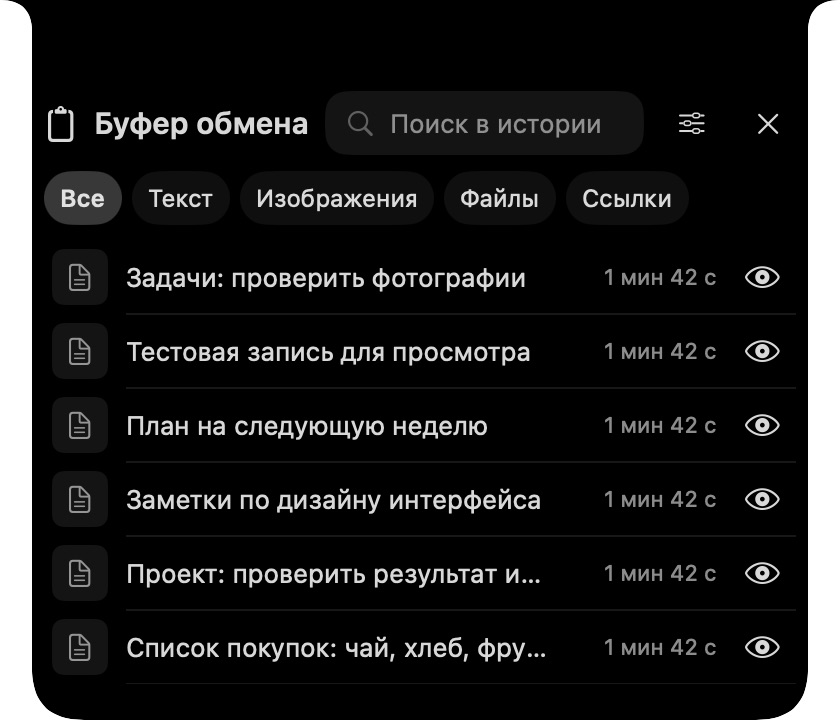

<div align="center">

# NotchClip

**Твой буфер обмена — прямо под чёлкой Mac.**

Текст, ссылки, изображения и файлы всегда под рукой. Наведи курсор на чёлку или нажми **⌘ ⇧ V**.


</div>



## Возможности

- **История под чёлкой.** Панель плавно открывается при наведении, из строки меню или по горячей клавише. На экране без чёлки используется центр верхнего края.
- **Текст, ссылки и изображения.** Ищи по содержимому, фильтруй записи, просматривай полный текст и изображения, редактируй текст и закрепляй важное. HTTP- и HTTPS-ссылки распознаются автоматически.
- **Файлы.** Перетащи файл в панель или скопируй его в Finder — NotchClip сохранит собственную копию. Чтобы вернуть файл, выбери запись для копирования или перетащи её в Finder. Поддерживаются обычные файлы; папки пока не поддерживаются.
- **Действия рядом.** Нажми на запись правой кнопкой мыши или двумя пальцами на трекпаде, чтобы открыть контекстное меню. Кнопка с глазом показывает полную запись.
- **Настройка под себя.** Выбери готовый размер панели или введи точные размеры, настрой горячую клавишу, задержки и анимацию. Учитываются системные настройки уменьшения движения и прозрачности.

Выбор записи возвращает её в системный буфер: вставь её через **⌘ V**. Наведение на чёлку не забирает фокус у текущего приложения. Закреплённые записи остаются вверху и не вытесняются обычной историей. Хранятся до 100 незакреплённых записей. Кнопка «Очистить» предлагает удалить незакреплённые записи или всю историю, включая закреплённые; текущий системный буфер не изменяется.

## Установка

Нужны Mac с Apple Silicon, **macOS 13 или новее** и Apple Command Line Tools либо Xcode.

```bash
git clone https://github.com/petroyarbot/clipboard.git
cd clipboard
./scripts/build-app.sh
```

Перенеси `build/NotchClip.app` в папку «Программы» и открой его. Сборка подписывается локальной ad-hoc подписью, поэтому macOS может попросить подтвердить открытие приложения. Автозапуск при входе пока не настроен.

## Приватность и хранение

История остаётся на Mac в `~/Library/Application Support/NotchClip/`; приложение не отправляет её в сеть. **Хранилище не зашифровано**, в том числе сохранённые копии файлов. Не помещай в историю данные, которые нельзя оставлять на диске.

Приложение пропускает данные, которые источник пометил как скрытые или временные, но не все программы выставляют такие отметки. При удалении записи файла из истории её сохранённая копия удаляется; оригинал в исходной папке не затрагивается. Для передачи файла в Finder создаётся временная копия, которая может храниться во временной папке до следующей очистки приложения.

## Разработка и тесты

Проект написан на Swift с использованием SwiftUI и AppKit. Сторонних зависимостей нет.

```bash
./scripts/test.sh   # поведение панели и изолированный системный буфер
./scripts/test-focus.sh # проверка фокуса; нужен графический сеанс macOS
swift test          # дополнительные XCTest; нужна полная Xcode
./scripts/build-app.sh
```

Скриншот выше сделан на тестовых данных. Проверки включают историю, совместимость старого формата, текст, изображения и копии файлов. Перетаскивание между приложениями и плавность анимации дополнительно проверяются на Mac.

Геометрия и подход к анимации вдохновлены [DynamicLanding](https://github.com/bring-shrubbery/dynamic-landing); текст лицензии находится в `THIRD_PARTY_LICENSES`.
